# Liminal HQ Labs organisation repository

<p align="center"></p>

The organisation-level home for [Liminal HQ Labs](https://github.com/liminal-hq-labs), the experimental sibling of [Liminal HQ](https://github.com/liminal-hq).

## What's here

- [`profile/README.md`](profile/README.md) — the landing page on the organisation's GitHub profile
- [`docs/labs-charter.md`](docs/labs-charter.md) — what a Labs project is, how it graduates or is retired, and how to start one
- [`assets/labs-hero.svg`](assets/labs-hero.svg) — the animated hero banner
- [`assets/labs-logo.svg`](assets/labs-logo.svg) — the Labs logo, square, for the organisation picture
- [`AGENTS.md`](AGENTS.md) — house rules for contributors and agents

New projects start from [`labs-template`](https://github.com/liminal-hq-labs/labs-template). Shared CI images and reusable workflows live in [`liminal-hq/.github`](https://github.com/liminal-hq/.github).

## Checks

```sh
bash scripts/check-headers.sh   # SPDX headers
bash scripts/check-banner.sh    # banner rules and text fit in headless Chromium
```

CI also runs markdownlint. The full list is in [AGENTS.md](AGENTS.md#testing).

## Licence

Licensed under either of the [Apache License, Version 2.0](LICENSE-APACHE) or the [MIT licence](LICENSE-MIT), at your option.
