# Liminal HQ Labs

**Experiments from Liminal HQ — early, rough and open.**

Labs is where [Liminal HQ](https://github.com/liminal-hq) tries things before they are ready. Each project here starts as a question — could this tool exist, and would it be calm to use? — and is built in the open while the answer takes shape. Some experiments grow up and move to Liminal HQ. Others teach us something and are put away.

## What we're trying

- [Mailslot](https://github.com/liminal-hq-labs/mailslot) — a private drop slot for files sent your way.

More experiments soon.

## How Labs works

- **Experimental status.** Every project here is early. Expect rough edges, missing pieces and honest status notes in each README.
- **Things may change or be dropped.** Interfaces, file formats and whole projects can change or be retired without a deprecation period. Retired projects are archived with a note, never deleted.
- **Graduation.** When an experiment proves itself, its repository moves to [Liminal HQ](https://github.com/liminal-hq) with its history, stars and links intact.

The details are in the [Labs charter](https://github.com/liminal-hq-labs/.github/blob/main/docs/labs-charter.md).

## Our approach

- **Local first**: experiments run on your machine; the cloud is optional, not foundational.
- **User sovereignty**: open formats and portable data, even in a prototype.
- **Calm computing**: try ideas that reduce noise instead of adding to it.
- **Craftsmanship**: rough is fine, careless is not — same house rules, tests and licences as everything else we ship.

## Explore

- Studio site: [liminalhq.ca](https://liminalhq.ca/)
- Labs site: [labs.liminalhq.ca](https://labs.liminalhq.ca/)
- The Lab: [liminalhq.ca/the-lab](https://liminalhq.ca/the-lab/)
- Liminal HQ on GitHub: [github.com/liminal-hq](https://github.com/liminal-hq)

## Organisation infrastructure

The organisation profile, the Labs charter and the house rules live in [`.github`](https://github.com/liminal-hq-labs/.github). New projects start from [`labs-template`](https://github.com/liminal-hq-labs/labs-template). Shared CI images and reusable workflows come from Liminal HQ's [`.github`](https://github.com/liminal-hq/.github).
